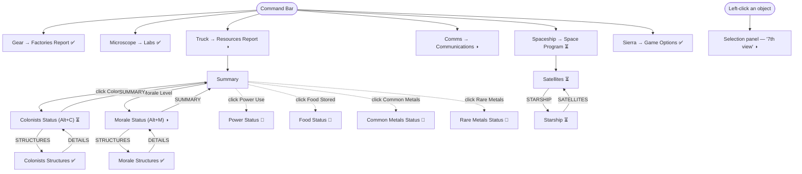

# OP2 in-game menu structure (visual reference)

The complete in-game sidebar UI: the **command bar** (6 buttons under the minimap) and the panels
they open, the Resources Report **drill-down navigator**, and the **object selection panel** ("7th
view"). Reconstructed from the original + the OP2 screenshots; this is the map we're building to.

**Legend** — implementation status in the remake:
`✅ live` (real data from the World) · `◑ partial` (some fields live, rest placeholder) ·
`⏳ sim` (layout built, values await a Phase-3 sim) · `🔲 TODO` (not built yet).

---

## Command bar (left → right)

| # | Icon (art group) | Opens | Hotkey | Status |
|---|------------------|-------|--------|--------|
| 0 | Gear `41`        | **Factories Report** | — | ✅ list / ⏳ production |
| 1 | Microscope `44`  | **Labs: Current Research** | — | ✅ list / ⏳ research |
| 2 | Truck `43`       | **Resources Report** (navigator) | — | ◑ (see below) |
| 3 | Comms `42`       | **Communications: Messages** | — | ◑ mark / ⏳ log |
| 4 | Spaceship `45`   | **Space Program: Satellites** | — | ⏳ sim |
| 5 | Sierra logo `40` | **Game Options** | — | ✅ buttons / 🔲 actions |



---

## 0. Factories Report  ✅ list
One entry per factory the local player owns + production status (sim-blocked → "Producing Nothing").
```
Structure Factory # 1-01
    Producing Nothing
Vehicle Factory # 1-01 / Arachnid Factory / Consumer Factory / Spaceport
    Producing …
```
Double-click an entry → centre map + select it. Source: `factoriesReport()`.

## 1. Labs: Current Research  ✅ list
One entry per lab + research status (→ "Researching Nothing").
```
Advanced Lab / Standard Lab / Basic Lab  # 1-01
    Researching Nothing
```
Source: `labsReport()`.

## 2. Resources Report  (navigator)
The Summary's lines **drill down** into per-category Status pages; each Status has a **STRUCTURES**
list. Bottom buttons are contextual: Status → `STRUCTURES` / `SUMMARY`; Structures → `DETAILS` /
`SUMMARY`. Page state = `ResourcesPanel.page` (the panel owns it; see `ResourcesPanel.qml`).

```
Summary (Resources Report)              ✅ mine/smelter counts; rest ⏳
├─ Colonists      ──┐ (click)
├─ Morale Level   ──┤
├─ Power Use      ──┤
├─ Food Stored    ──┤
├─ Common Metals  ──┤
└─ Rare Metals    ──┘

Colonists Status (Alt+C)                ⏳ sim
├─ Total Population / Residence Capacity / Children
├─ Workers: Assigned x/y, Available
├─ Scientists: as Scientists x/y, as Workers, to Research, Available
└─ [STRUCTURES] → Colonists Structures  ✅  (University, Nursery, Medical Center + Active/Idle)

Morale Status (Alt+M)                    ◑
├─ <Level> (<Trend>)  <0-100>  + bar     ⏳
├─ Residence / Rec. Facility / Med. Center Demand %   ⏳
├─ Net Food Production, Disabled Bldg. Ratio, Unoccupied, Scientists as Workers  ⏳
├─ Nursery / University / GORF  Operational            ✅ derived (owns an active one)
├─ Disaster Warning Systems, DIRT: Avg Damage Prev. %  ⏳
└─ [STRUCTURES] → Morale Structures      ✅  (residences, recreation, consumer, medical + status)

Power / Food / Common Metals / Rare Metals Status   🔲 (drill-downs not built — need screenshots)
```
Sources: `resourcesReport()`, `colonistsReport()`, `moraleReport()`, `colonistStructures()`,
`moraleStructures()` (the structures lists use a shared `structureList()` — fully derivable).

## 3. Communications: Messages  ◑
```
167: Current Mark                         ✅ live (gameClock.mark)
166: 1 Structure Disabled   (red)         ⏳ needs event system
166: 1 Worker has died      (red)
166: 1 Child born           (green)
…  newest-first, green = info / red = warning
[▲] [▼]  [JUMP]                            🔲 nav buttons
```
Source: `commsMessages()` (empty until the event/message system feeds it).

## 4. Space Program  ⏳ — two pages (toggle button)
```
Satellites (default)                       ⏳
  Communications Satellite:  Not Operational (red)
  Solar Satellite:           Not Operational (red)
  [STARSHIP]  →  Starship page

Starship (via STARSHIP)                     ⏳
  Ion Drive Module      Researched/Not (red until done)
  Fusion Drive Module   …
  Fueling Systems       …
  Skydock               …
  [SATELLITES]  →  back
```
Sources: `spaceReport()` (Not Operational) + `starshipReport()` (Not Researched) until the
space/research sims. (▲▼ scroll buttons TODO; more starship components may exist.)

## 5. Game Options  ✅ buttons
Four OP2-style buttons (art group 50):
```
[ MISSION OBJECTIVES ]   🔲 action
[ ONLINE MANUAL      ]   🔲 action
[ PREFERENCES        ]   🔲 action
[ END MISSION        ]   🔲 action
```
The **developer/debug controls** (game speed, render toggles, exports, scene loaders, EDWARD survey)
live under this menu, below End Mission (scrollable).

---

## Object selection panel — the "7th view"  ◑
Triggered by **left-clicking an object** (not the command bar). Right-click deselects. Shows when an
object is selected and no command report is open.
```
[icon]  Name # <player>-<NN>             ✅
        <Armor class>                     ✅
        <hp>/<maxHp>                      ✅
        ──────── HP bar ────────
Status:        Active/Idle/Disabled       ✅ (state-coloured)
Weapon:        <name>                      ✅ (armed units)
Power/Workers/Scientists: <req>            ✅ (from building.txt)
[ IDLE / ACTIVATE ]                        ✅
── Debug ──
Owner: Player N (friendly/enemy)           ✅
Kind / ID (index gen) / Location           ✅
```
- **Portrait box** = art group 54; **category icon** from `ui/tech/Tech_*.png` (per the hardcoded
  category map). Sources: `selectedInfo` + `world.type()`.
- Spec: `docs/SELECTION_PANEL.md`.

---

## Hotkeys (from screenshots)
- **Alt+C** → Colonists Status · **Alt+M** → Morale Status. (Other sub-report hotkeys TBD.)

## Fonts / colours (measured, see `docs/UI_REFERENCE.md`)
- **Arial via GDI** (non-antialiased). Title ~13px bold, body ~11px, upgrade/notes ~10–11px.
- Panel text **`#00ff00`**; sub-line/dim green `#00b400`; warnings/Not-Operational `#ff3030`;
  Idle gray; OP2 red-bordered buttons `#b03030`.

## Still to map (need OP2 screenshots)
- The **Power / Food / Common Metals / Rare Metals** Status drill-downs (+ their Structures lists).
- The panels' **nav/action buttons** (▲▼ scroll, JUMP, STARSHIP, the Game-menu actions).
- Any sub-report hotkeys beyond Alt+C / Alt+M.

Related docs: `COMMAND_PANELS.md` (per-panel field spec + data deps), `SELECTION_PANEL.md`,
`UI_REFERENCE.md` (pixel measurements), `INTERFACE_SKINS.md` (HUD bitmaps).
